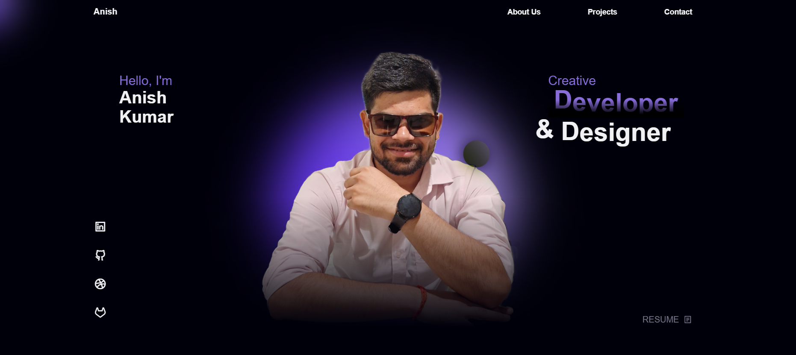
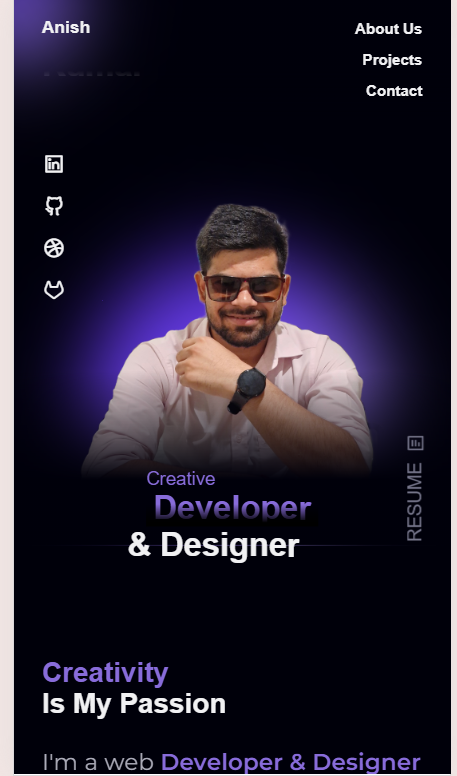

# 🌐 Personal Portfolio Website

A modern, responsive personal portfolio website designed to showcase my
skills, projects, experience, and contact information as a frontend developer.

## 🚀 Live Demo

🔗 [View Live Website](https://anish-portfolio-five-woad.vercel.app/)

## 📸 Screenshots

### 🖥️ Desktop View



### 📱 Mobile View



## ✨ Features

- Fully responsive design
- Modern and clean UI
- Hero section with introduction
- About Me section
- Skills and technologies section
- Projects showcase
- Contact section
- Smooth navigation
- Mobile-friendly layout
- Interactive UI elements
- Optimized for different screen sizes

## 🛠️ Technologies Used

- HTML5
- CSS3
- JavaScript
- Responsive Web Design
- Font Awesome / Icons
- Google Fonts

## 📂 Project Structure

```text
portfolio/
│
├── index.html
├── style.css
├── main.js
├── assets/
│   ├── images/
│   └── ...
├── screenshots/
│   ├── desktop.png
│   └── mobile.png
├── README.md
└── .gitignore